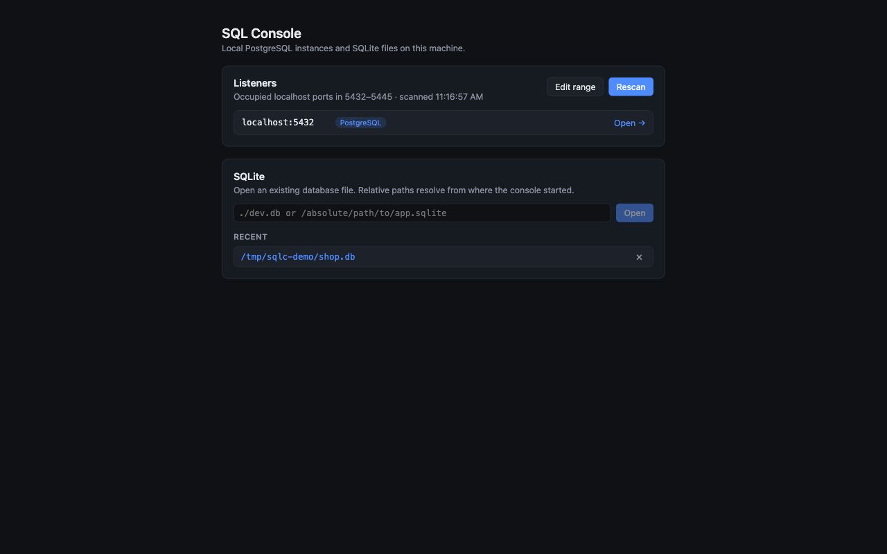
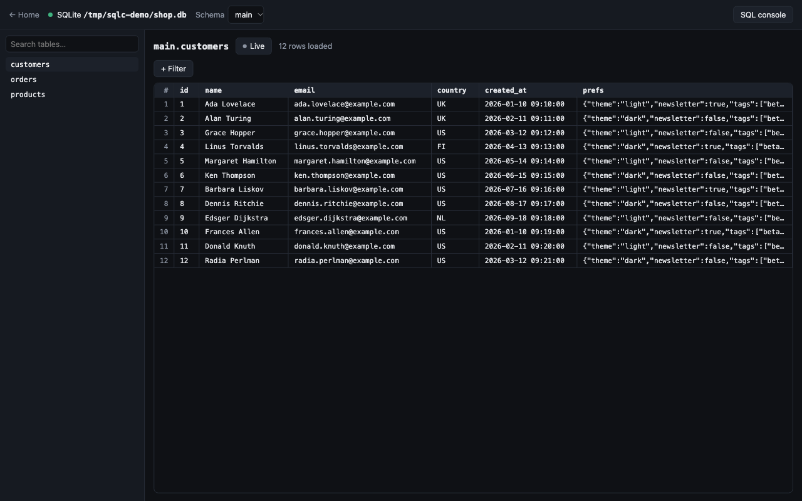
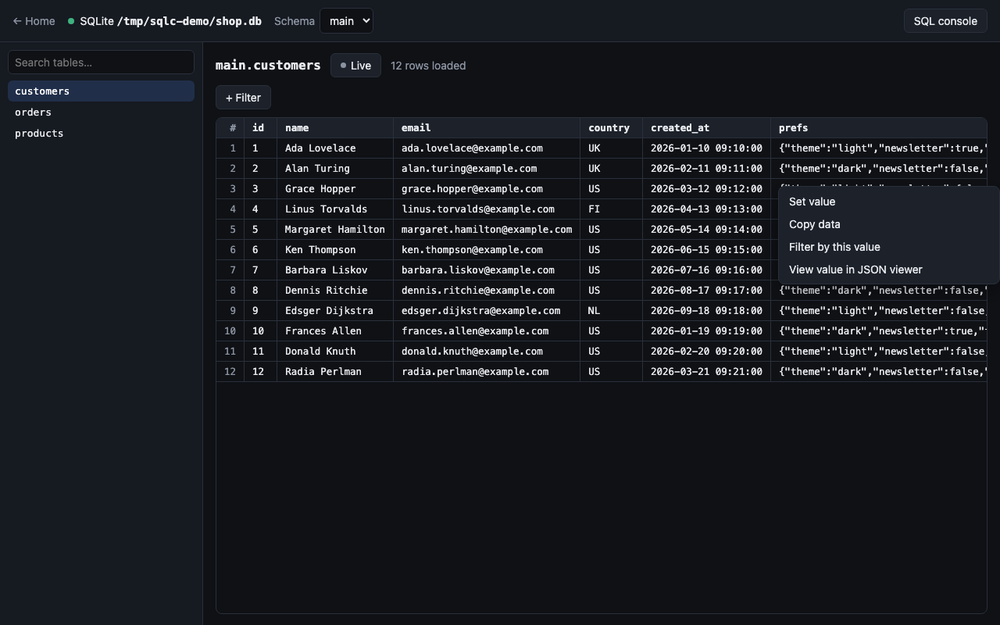
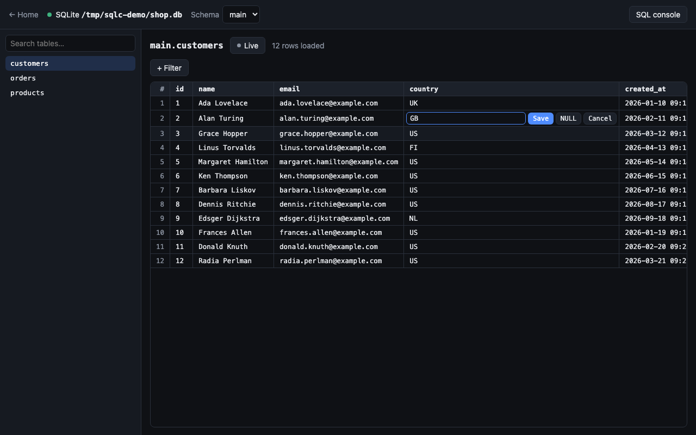
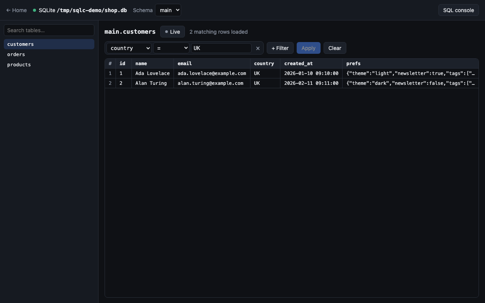
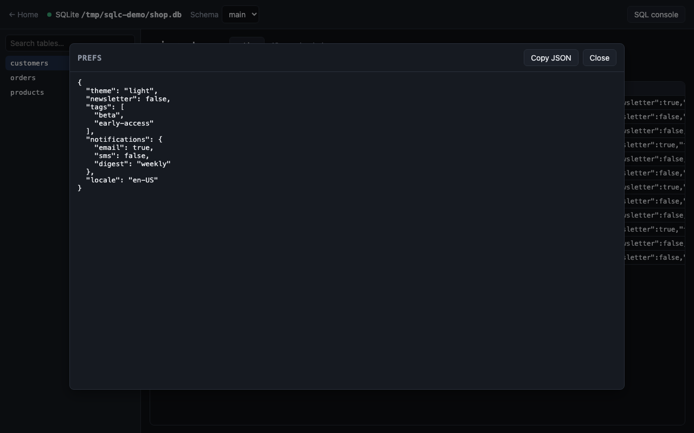
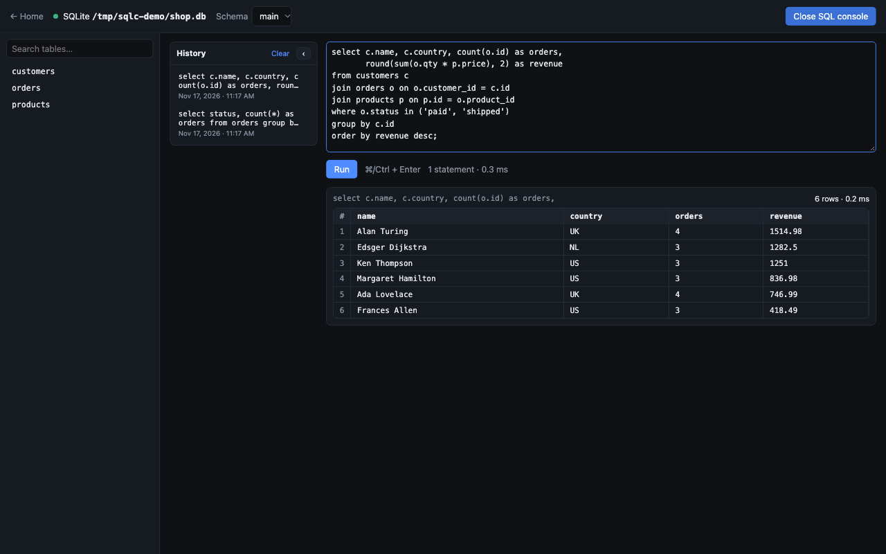

# SQL Console

A local-only tool for inspecting the databases on your machine and running raw SQL against them. It supports PostgreSQL and SQLite.

## Screenshots

### Home

The console scans localhost ports for PostgreSQL instances. You can also open a SQLite database by its file path. Recently opened SQLite files are listed so you can reopen them in one click.



### Browse tables

Pick a schema and a table to see its rows. You can sort by column and add filters.



### Cell menu

Right-click any cell in a table to open its menu. Press Esc or click elsewhere to close it.



#### Set value

Edit the cell in place. Press Enter or **Save** to write the new value, **NULL** to clear it, and Esc or **Cancel** to discard your change. This option is disabled for tables without a primary key.



#### Copy data

Copy the cell's value to the clipboard as text. A `NULL` cell copies as the word `NULL`.

#### Filter by this value

Add a filter that matches the cell's value, on top of any filters already applied. A `NULL` cell adds an `is null` filter.



#### View value in JSON viewer

Open the value as formatted JSON, with a **Copy JSON** button. If the value is not valid JSON, the viewer shows the parse error instead. Press Esc, **Close**, or click outside the viewer to dismiss it.



### SQL console

Run raw SQL with ⌘/Ctrl + Enter. Each run is saved to a history panel, so you can bring earlier queries back.



## Getting started

```sh
pnpm install
pnpm dev      # API on 127.0.0.1:4848, UI on http://127.0.0.1:5173
```

To build and run the production version:

```sh
pnpm build
pnpm start    # serves everything on http://127.0.0.1:4848
```

| Variable           | Default          | Purpose                                              |
| ------------------ | ---------------- | ---------------------------------------------------- |
| `PORT`             | `4848`           | Port the server listens on                           |
| `SQL_CONSOLE_HOME` | `~/.sql-console` | Where settings, saved logins, and run history are kept |

The server only listens on the loopback interface (see [ADR 0002](docs/adr/0002-local-web-server-bound-to-loopback.md)).

## Development

```sh
pnpm typecheck
pnpm test
```

The project's terms are defined in [CONTEXT.md](CONTEXT.md), and design decisions are recorded in [docs/adr](docs/adr).
